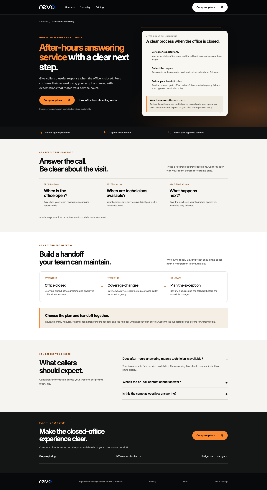
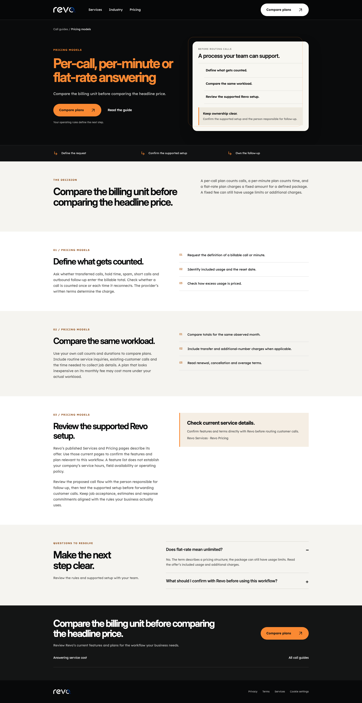
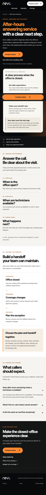
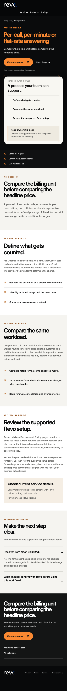

# Revo current design and shared new-guide model

Local screenshots, not a production deploy. Human visual review remains pending. Both use the approved current Revo call-design CSS, brand assets and fonts. The new model replaces domain-specific call content with guide navigation and checklist modules. No mock data or fictional call records.

| Current after-hours page, desktop | New pricing-model guide, desktop |
|---|---|
|  |  |

| Current page, mobile | New shared model, mobile |
|---|---|
|  |  |

Additional samples: [Calendar booking, desktop](visual-qa/calendar-booking-checklist-1440.png), [Calendar booking, mobile](visual-qa/calendar-booking-checklist-390.png), [Plumbing on-call, desktop](visual-qa/plumbing-on-call-policy-1440.png), [Plumbing on-call, mobile](visual-qa/plumbing-on-call-policy-390.png).

The local server is GET-only, bound to 127.0.0.1:8765 and sends noindex headers. Only the disposable preview-source copy has local-preview approvals. The deliverable branch's 20 records remain draft; canonical, sitemap and routes for the preview demonstrate the behavior after a future real approval.
